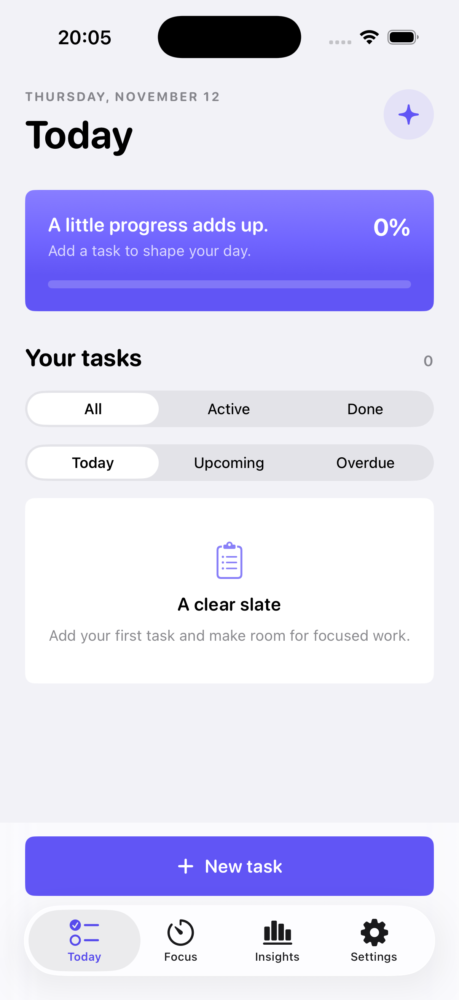
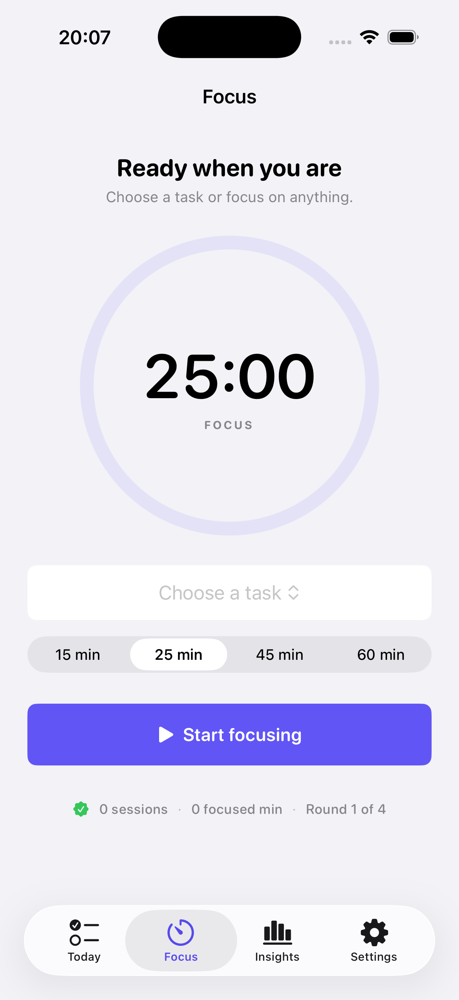
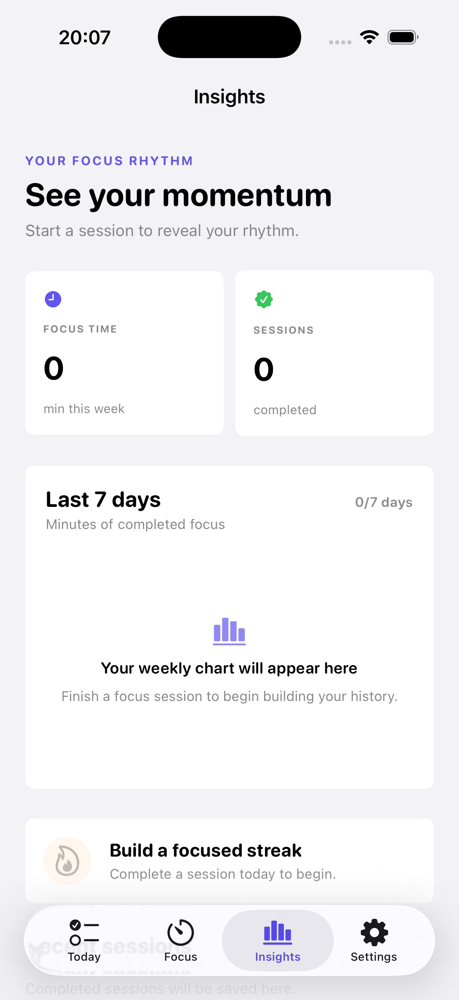

# FocusLog

FocusLog is a local-first iOS focus companion for planning tasks, running distraction-free focus sessions, and reviewing personal focus habits over time.

Built as a native SwiftUI project with no third-party dependencies or backend services.

<p align="center">
  
  
  
</p>

## Features

- Create, edit, filter, complete, and delete tasks.
- Organize tasks into Today, Upcoming, and Overdue scopes; completed tasks remain in Today on the day they were completed.
- Assign a category, estimated duration, and optional due time to each task.
- Receive a local notification when a future task becomes due.
- Run 15, 25, 45, or 60-minute focus sessions, optionally linked to a task.
- Follow a persistent Pomodoro cycle: a 5-minute break after each focus session and a 15-minute break after every fourth completed session.
- Pause, resume, and reset active sessions; restore an active focus or break timer after the app returns from the background or relaunches.
- Receive a local notification when a running focus session or break finishes, even when the app is backgrounded.
- Save completed sessions locally and review a 7-day focus chart, recent sessions, and a current streak.
- Browse a searchable, date-grouped history of every completed focus session.
- Navigate from the Today dashboard into task details; edit, complete, or delete a task from its dedicated screen.
- Manage appearance, notification permission, and app information from a Settings tab.
- Support light and dark system appearances with accessibility labels for core controls.

## Tech Stack

- Swift 5
- SwiftUI
- SwiftData
- Charts
- UserNotifications
- Observation / UserDefaults

## Architecture and Key Decisions

The project uses a feature-first structure. `AppRouter` owns tab selection and each tab's navigation path, keeping push navigation separate from leaf views. Feature views stay close to their UI while persistence and timer behavior remain in focused core types:

- `FocusTask` and `FocusSession` are SwiftData models. The app is fully usable offline and requires no account.
- `FocusTimerController` is a persisted state machine for focus, short-break, and long-break phases. Instead of decrementing a counter in the background, it persists a deadline and derives the remaining time from the current clock. This keeps elapsed time correct after backgrounding or relaunching and makes the four-session Pomodoro transition deterministic.
- `TaskReminderService` schedules and cancels local reminders whenever a task changes. A completed task will not notify the user.
- `FocusInsightsCalculator` aggregates stored sessions by calendar day for its 7-day chart and computes the current streak. It deliberately counts only completed focus sessions, and its pure logic is unit tested.
- The selected tab is remembered between launches. This is a small but deliberate continuity detail for a tab-based productivity app.

## Project Structure

```text
FocusLog/
├── App/
│   ├── FocusLogApp.swift           # App entry point and SwiftData container
│   ├── RootTabView.swift            # Root navigation
│   └── Navigation/
│       └── AppRouter.swift          # Tab and navigation-path state
├── Core/
│   ├── Analytics/
│   │   └── FocusInsightsCalculator.swift
│   ├── Models/
│   │   ├── FocusSession.swift
│   │   └── FocusTask.swift
│   ├── Services/
│   │   ├── FocusTimerNotificationService.swift
│   │   └── TaskReminderService.swift
│   └── Timer/
│       └── FocusTimerController.swift
└── Features/
    ├── Focus/
    │   └── FocusTimerView.swift
    ├── Insights/
    │   ├── InsightsView.swift
    │   └── SessionHistoryView.swift
    ├── Settings/
    │   └── SettingsView.swift
    ├── Tasks/
    │   ├── TaskDetailView.swift
    │   └── TaskEditorView.swift
    └── Today/
        ├── Components/
        │   ├── TaskRow.swift
        │   ├── TaskScopePicker.swift
        │   └── TodayProgressCard.swift
        └── TodayView.swift
FocusLogTests/
└── FocusLogTests.swift
```

## Requirements

- Xcode 26.6
- iOS 17.0 or later

## Run Locally

1. Clone this repository.
2. Open `FocusLog.xcodeproj` in Xcode.
3. Select an iOS simulator or a signed device.
4. Build and run with `Cmd + R`.
5. Grant notification permission when prompted if you want task reminders and focus-completion alerts.

## Verification

The app can be compiled for an iOS simulator with:

```bash
xcodebuild -project FocusLog.xcodeproj \
  -scheme FocusLog \
  -destination 'platform=iOS Simulator,name=iPhone 17' \
  build
```

The project includes five unit tests for the timer state machine and insight calculations. Run them with:

```bash
xcodebuild -project FocusLog.xcodeproj \
  -scheme FocusLog \
  -destination 'platform=iOS Simulator,name=iPhone 17' \
  test
```

## Design Assets

The included App Icon is a custom vector-designed clock and completion mark, exported as a 1024px iOS asset. The screenshots above were captured from the iPhone 17 simulator against the current build.

## Privacy

FocusLog stores tasks, session history, and timer recovery state only on the device. It does not collect analytics, require sign-in, or send user data to a server.
